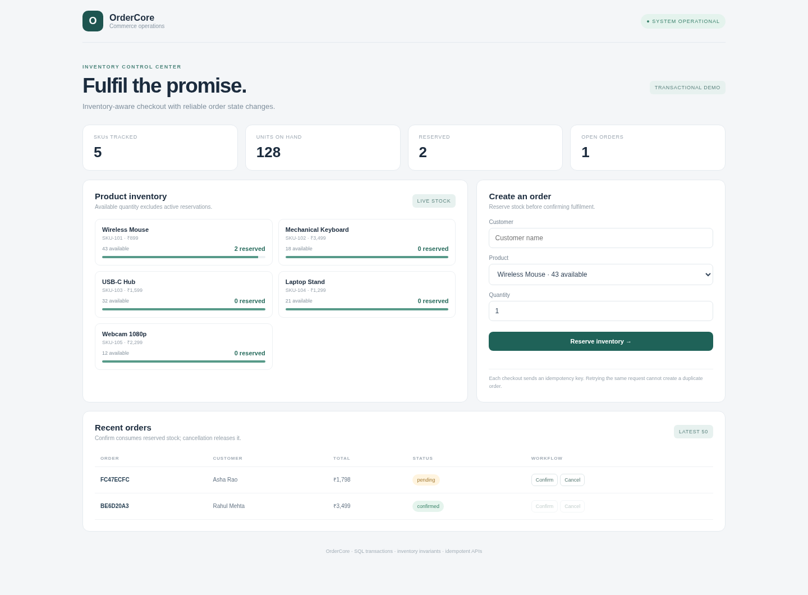

# OrderCore — transactional order and inventory service

OrderCore demonstrates the backend parts of checkout that are easy to get wrong: race-safe reservations, retry-safe order creation, and consistent order transitions. It provides a browser operations dashboard and a REST API backed by SQLite transactions.



## Features

- Product catalogue with stock-on-hand, reserved, and available quantities.
- Checkout reserves inventory atomically; overselling is rejected.
- Mandatory `Idempotency-Key` makes network retries safe. Same key + same payload replays the original order; same key + different payload returns `409`.
- Confirmation consumes reserved inventory; cancellation releases reservations.
- Order state transitions are enforced (`pending → confirmed | cancelled`).
- Integer paise storage avoids floating-point money arithmetic.
- Foreign keys, `CHECK` constraints, indexes, transactional writes, and order event history.

## Stack and requirements

Node.js 22.5+, native `node:http`, native `node:sqlite`, SQL, HTML, CSS, vanilla JavaScript, and `node:test`. No external packages or database server are needed.

## Setup

```bash
node --version    # 22.5+
npm start
# open http://localhost:3002
```

The first launch creates `data/ordercore.sqlite` and seeds five products. Configure a different port/database with `PORT=3012 DB_PATH=./data/dev.sqlite npm start` (PowerShell: `$env:PORT=3012; npm start`).

## Tests

```bash
npm test
npm run check
```

Tests run against an in-memory SQLite database and exercise successful and rejected checkout flows, idempotent retries, inventory invariants, confirmation, and cancellation.

## API reference

| Method | Endpoint | Purpose |
|---|---|---|
| GET | `/api/health` | Health check |
| GET | `/api/products` | Products and available inventory |
| GET | `/api/inventory/summary` | Stock and reservation totals |
| GET | `/api/orders` | Latest 50 orders |
| POST | `/api/orders` | Create order and reserve stock |
| GET | `/api/orders/:id` | Order, lines, and event history |
| POST | `/api/orders/:id/confirm` | Consume reserved stock |
| POST | `/api/orders/:id/cancel` | Release reserved stock |

Create an order:

```bash
curl -X POST http://localhost:3002/api/orders \
  -H 'content-type: application/json' \
  -H 'Idempotency-Key: checkout-2026-demo-001' \
  -d '{"customerName":"Asha Rao","items":[{"sku":"SKU-101","quantity":2}]}'
```

## Architecture

```text
Operations dashboard
       │ REST / JSON
       ▼
HTTP API + input validation
       │
       ▼
Order domain service ── idempotency hash / state machine
       │                 └── BEGIN IMMEDIATE transaction
       ▼
SQLite: products / orders / order_items / order_events
       └── constraints preserve stock and reservation invariants
```

## Screenshots

- `screenshots/dashboard.png` — catalogue inventory, stock summary, order form, and recent order workflow.

## Engineering notes and production extensions

SQLite serializes write transactions for this single-process demonstration. In a horizontally scaled deployment, use PostgreSQL transactions with row-level locking or conditional updates, a durable idempotency store, an outbox for downstream events, and payment-provider idempotency. Payment processing, shipping integrations, authentication, and multi-warehouse stock are intentionally out of scope.
